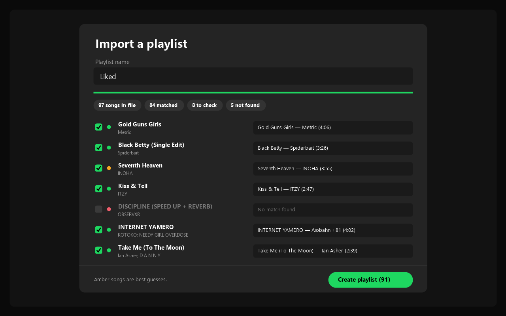

# File to Playlist



Turn a CSV or M3U file into a Spotify playlist. Drop the file onto Spotify, check the matches, create the playlist.

A [Spicetify](https://spicetify.app) extension.

> The preview above is an illustration of the import screen, not a screenshot.

## ✨ Features

- **Drag and drop.** Drop a `.csv` or `.m3u` file anywhere onto Spotify and the importer opens with it. Or use **Import playlist from file** in the profile menu.
- **Finds every song on Spotify** and shows how sure it is:
  - 🟢 **Matched**
  - 🟠 **Check this**: a best guess worth a look
  - 🔴 **Not found**
- **Pick a different match** from a dropdown of up to five Spotify results per song, or untick songs you don't want.
- **Uses song lengths** from M3U files to pick the right version of a track.
- **Spotify links in the file are used directly**, without searching.
- **Quick selecting.** Click a row to tick or untick it, **Shift+click** to do a whole range, **Ctrl+click** for a single row, and **Select all** or **Ctrl+A** for everything.
- **Songs not added**: a list of everything that won't go into the playlist (not found, search failed or unticked), ready to copy as a plain list or as a CSV you can import again later. Failed searches can be retried in one click.
- **Skips duplicates** if you want.
- **Nothing changes until you press Create.** When it's done, **Open playlist** takes you straight there.

## 📄 Supported files

| Format | What it reads |
| ------ | ------------- |
| **M3U / M3U8** | `#EXTINF` lines (`Artist - Title` and length), `#PLAYLIST` names, file names like `Artist - Title.mp3`, and Spotify track links |
| **CSV / TSV** | A header row with a title column and ideally an artist column. Common names work: `Title`, `Track Name`, `Song`, `Artist`, `Artist Name(s)`, `Album`, `Duration (ms)`, `Spotify URI`. Commas, semicolons and tabs are all fine |

Exports from YouTube Music tools, Exportify and most music players work as they are. Multiple artists can be separated with `;`, `,`, `&` or `feat.`.

## 📦 Install

### Marketplace

Open the [Spicetify Marketplace](https://github.com/spicetify/marketplace), search for **File to Playlist** and click install.

### Manual

1. Download [`fileToPlaylist.js`](fileToPlaylist.js) into your Spicetify `Extensions` folder.

   | Platform        | Path                              |
   | --------------- | --------------------------------- |
   | **Windows**     | `%appdata%\spicetify\Extensions\` |
   | **Linux/macOS** | `~/.config/spicetify/Extensions/` |

2. Run:

   ```
   spicetify config extensions fileToPlaylist.js
   spicetify apply
   ```

## 🎵 Usage

1. Drag a CSV or M3U file onto Spotify, or open **Import playlist from file** from the profile menu.
2. Check the name and the matches. Amber rows are worth a look; pick another match from the dropdown or untick the song.
3. Press **Create playlist**.
4. Open **Songs not added** (on the review screen or after creating) to copy the songs that didn't make it.

> [!TIP]
> Songs that only exist on YouTube (fan edits, sped-up versions, unofficial remixes) usually aren't on Spotify and will show as not found. That's expected.

## 🗑️ Uninstall

Remove it from the Marketplace **Installed** tab, or for a manual install run:

```
spicetify config extensions fileToPlaylist.js-
spicetify apply
```

> [!NOTE]
> Built for Spotify 1.3.5 with Spicetify 2.45.3 and checked against Spotify 1.3.6 with Spicetify 2.46.2. Searching uses your own Spotify session, three songs at a time, so a long file takes a minute or two. If something doesn't work, please [open an issue](https://github.com/superC12/spicetify-file-to-playlist/issues) with your Spotify version.

## 📋 Changelog

Related changes are combined under clean release versions.

### v1.2.0

- A search that hangs gives up after 8 seconds instead of stalling the list, and a search method that keeps failing is skipped for the rest of the import.
- Failed rows say why the search failed.
- Checked against Spotify 1.3.6 with Spicetify 2.46.2.

### v1.1.0

- Fixed searching on Spotify 1.3.5 using Spotify's own search.
- Added **Songs not added**, with plain-list and CSV export, and **Retry failed**.

### v1.0.0

- Initial release: CSV/M3U import, match review, duplicate skipping and playlist creation.
- Select all, Ctrl+A, Shift+click ranges and Ctrl+click selection.
- File-drop status with reading progress, song count and import errors; drops are caught before Spotify handles them.

## License

[MIT](LICENSE)
